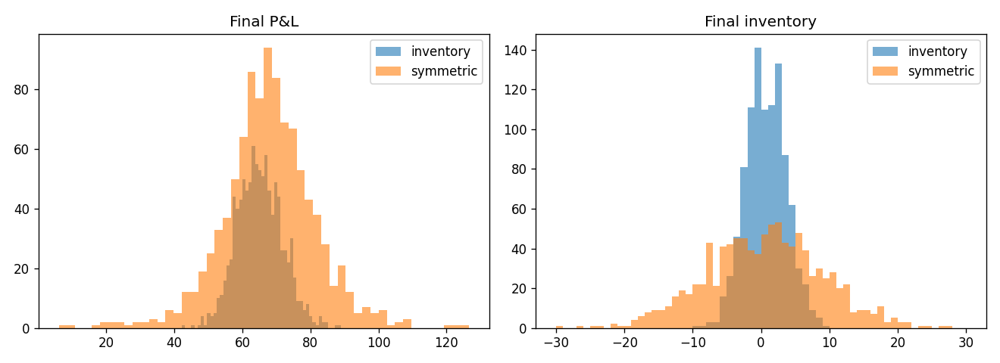
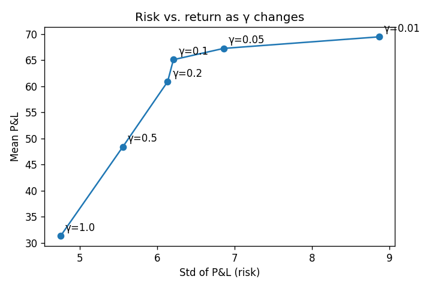
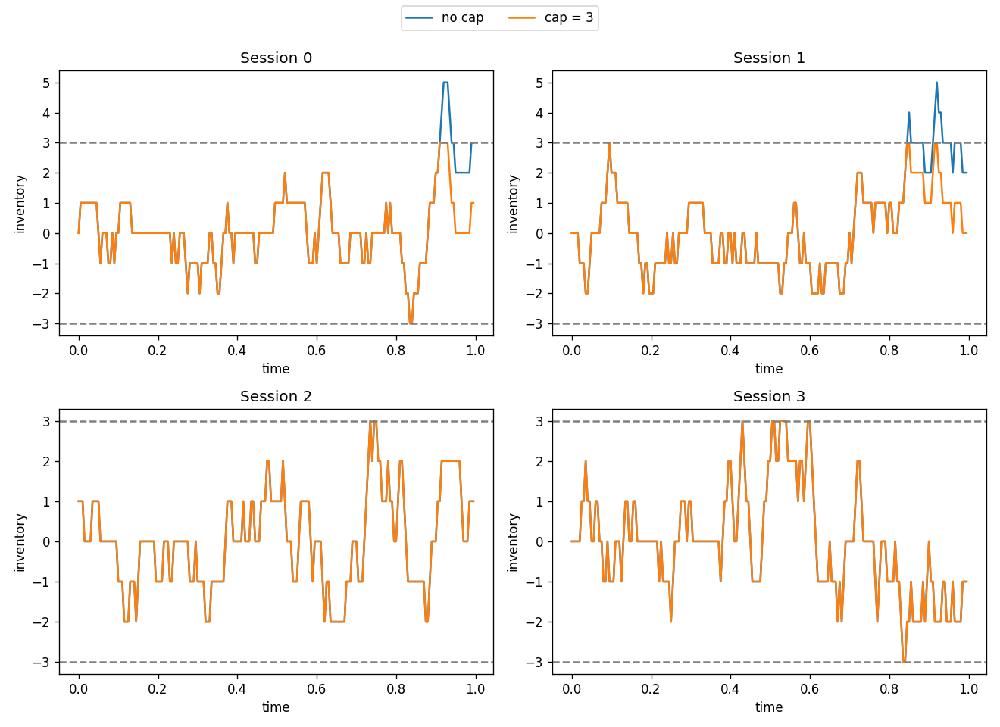
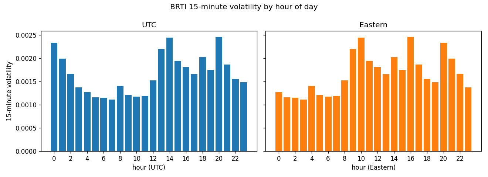
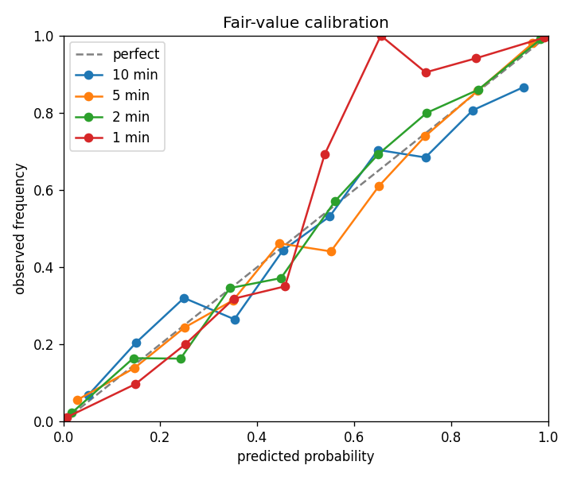

# mm-sim: Avellaneda-Stoikov market making
A simulation of the Avellaneda-Stoikov market-making model: how quoting around an inventory-adjusted price cuts risk. Key result: about half the P&L risk for a ~4% lower mean P&L.

## Model
- Reservation price: r = s - q·γ·σ²·(T - t)
- Total spread: γ·σ²·(T - t) + (2/γ)·ln(1 + γ/k)
- Fill chance per step for a quote δ from the mid: A·e^(-kδ)·dt
- State (s, x, q, t) changes each step; settings (σ, γ, k, A, T, dt, s0) live in `avellaneda_stoikov/params.py`.

## Run
    python -m venv .venv && source .venv/bin/activate    # Windows: py -3.12 -m venv .venv, then .venv\Scripts\activate
    pip install -e ".[dev]"
    pytest
    python run_experiments.py   # prints the table and writes figures/

## Results (1,000 sessions, paper parameters, seed 1)

| Strategy | Spread | Mean P&L | Std P&L | Std final q |
|---|---|---|---|---|
| Inventory | 1.49 | 65.04 | 6.63 | 2.93 |
| Symmetric | 1.49 | 67.80 | 13.70 | 8.45 |





The inventory strategy gives up about 3 in mean P&L to cut P&L risk roughly in half, matching the paper.


## Inventory caps

The inventory-aware strategy already pulls its quotes back toward zero inventory, but I wanted to see what happens if I also put a hard limit on how much inventory it can hold. With a cap of N, the bot stops quoting the bid when it's already long N and stops quoting the ask when it's short N. I ran 1,000 sessions per setting with the same seed, so the only thing that changes between rows is the cap.

| Max inventory | Avg spread | Mean P&L | Std P&L | Std final inventory | Max abs inventory |
|---------------|-----------|----------|---------|---------------------|-------------------|
| None          | 1.49      | 65.04    | 6.63    | 2.93                | 11                |
| 10            | 1.49      | 65.04    | 6.63    | 2.92                | 10                |
| 5             | 1.49      | 64.89    | 6.62    | 2.62                | 5                 |
| 3             | 1.49      | 63.86    | 6.50    | 1.91                | 3                 |



Same four sessions, same random prices, with and without a cap of 3. The lines match until the uncapped inventory crosses 3; after that the capped run stops quoting that side and stays inside the band.

**What I found:**
- A cap of 10 barely matters. It only clips the one session that got to 11.
- Tighter caps shrink inventory risk a lot. Std of final inventory drops from 2.93 to 1.91 at a cap of 3.
- It costs very little. Mean P&L only falls about 2% (65.04 to 63.86) at the tightest cap, because I skip some fills.
- P&L risk barely changes. The inventory-aware quoting already keeps P&L swings low, so the cap works more like a safety limit on the worst-case position than a way to smooth returns.

**Caveat:** this is one seed. The differences in mean P&L between caps (around 1 point) are small next to the std of about 6.6, so I wouldn't say one cap is better on P&L. The max inventory and inventory std differences are the clear ones.

## BRTI history

`fetch_brti.py` downloads CME CF Bitcoin Real Time Index (BRTI) history through Kalshi's CF Benchmarks passthrough. You need a Kalshi API key, not a separate CF Benchmarks login.

1. In Kalshi, open Account & security → API Keys → Create Key.
2. Copy the API key id shown on that page. Download the private key PEM and store it outside this repo. Kalshi cannot show the private key again.
3. Create `.env` in this folder:

```
KALSHI_API_KEY_ID=your-key-id
KALSHI_PRIVATE_KEY_PATH=path/to/your-key.pem
```

`.env`, `*.pem`, and `data/` are gitignored. Install dependencies with `pip install -e ".[dev]"`, then check one hour before a long pull:

```
python fetch_brti.py --probe
python fetch_brti.py --start 2026-10-28 --end 2026-10-31
```

`--probe` fetches a single completed hour (or the first hour of `--start`, if you pass one), prints the response keys, point count, first and last timestamps, and the gap between points, and writes the raw JSON to `data/brti/probe.json`. The date command then walks each UTC day from `--start` through `--end` inclusive, one request per hour, and writes `data/brti/YYYY-MM-DD.csv`. A day that already has a CSV is skipped. CF Benchmarks documents each point as `time` (int64) and `value` (string) under `payload`, and Kalshi wraps that body in `data`. The hour timestamp has to be truncated, like `2026-10-28T14:00:00.000Z`.

## Data

`python analyze_brti.py` reads those daily CSVs (the raw files stay gitignored). It keeps the last price in each second, forward-fills gaps of up to 5 seconds, and takes log returns only across seconds that both have a price. `vol_1s` is the standard deviation of those returns, `vol_15m` is that number times √900, and realized vol is √(sum of squared returns). These four days had a print every 200 ms, so no second was missing after the fill.

| Date | Missing seconds | Vol per second | 15-minute vol | Realized vol |
|---|---:|---:|---:|---:|
| 2026-10-28 | 0 | 5.09e-5 | 0.00153 | 0.0150 |
| 2026-10-29 | 0 | 7.56e-5 | 0.00227 | 0.0222 |
| 2026-10-30 | 0 | 8.68e-5 | 0.00261 | 0.0255 |
| 2026-10-31 | 0 | 2.88e-5 | 0.00086 | 0.0085 |

Friday was the busiest day and Saturday the quietest. By hour, the quiet stretch is about 05:00–07:00 UTC (01:00–03:00 Eastern), near 0.0011. The busy hours are 14:00 and 20:00 UTC (10:00 and 16:00 Eastern), near 0.0025.



Kalshi's 15-minute comparison, on 383 windows (the first one is skipped because the sample has no minute before it): 180 of 383 (47.0%) finished at or above the target. The median absolute move from target to final was 0.080%, and the standard deviation of final/target − 1 was 0.00200.

## Calibration

`python calibrate_fair_value.py` asks, at 10, 5, 2, and 1 minutes before each close, for the probability that the closing minute finishes at or above the target. Volatility is the standard deviation of the previous hour of 1-second price changes. The Brier score is the mean squared error of that probability. Predicting the sample's 47% base rate every time would score about 0.25.

| Minutes left | Windows | Brier |
|---|---:|---:|
| 10 | 380 | 0.189 |
| 5 | 380 | 0.127 |
| 2 | 380 | 0.071 |
| 1 | 380 | 0.039 |

Closer to the close, the score drops and the probability piles up near 0 and 1. Ten and five minutes track the diagonal. One minute has only a handful of windows in the middle buckets, so those frequencies jump around.




### Baseline comparison

Brier scores on 1,052 realized 15-minute BRTI windows (lower is better). Skill is `1 - brier_model / brier_const`.

| Horizon | n    | Model  | Const 0.5 | Base rate | Fixed σ | Skill |
|---------|------|--------|-----------|-----------|---------|-------|
| 10 min  | 1052 | 0.1981 | 0.2500    | 0.2496    | 0.1997  | 0.208 |
| 5 min   | 1052 | 0.1328 | 0.2500    | 0.2496    | 0.1369  | 0.469 |
| 2 min   | 1052 | 0.0743 | 0.2500    | 0.2496    | 0.0766  | 0.703 |
| 1 min   | 1052 | 0.0309 | 0.2500    | 0.2496    | 0.0328  | 0.876 |

`fair_value_up` beats every baseline at every horizon, and its skill grows from 0.21 at 10 minutes to 0.88 at 1 minute as settlement approaches. Its edge over a single fixed σ is small but consistent. This means most of the accuracy comes from the model's structure (spot relative to target, time left, and the 60-second averaging window), and estimating σ per window adds a modest gain on top. At the 10-minute horizon the extreme buckets are overconfident (predicted 0.95 settles YES 87% of the time). This suggests the trailing 1-hour σ understates BTC's fat tails at longer horizons, which is a candidate for future work.

## Avellaneda-Stoikov replay: tuning risk aversion (γ)

`replay_as.py` replays each 15-minute window second by second. It quotes a bid and ask around a reservation price
r = mid − q·γ·σ_p²·τ, with spread γ·σ_p²·τ + (2/γ)·ln(1 + γ/k).

- σ_p is the per-second std of the model fair value over the last 60 s.
- τ is seconds to settlement.
- Fills are simulated with probability A·exp(−k·distance) from the model fair value (k = 150, A = 0.05).
- Inventory is capped at ±10 contracts.
- PnL is cash plus inventory × the settlement outcome.

The quotes are centered either on the model fair value or on a flat 0.5 baseline.

| Strategy | Mean PnL / window | Std | Sharpe | Worst window | Mean \|q\| at settle |
|---|---|---|---|---|---|
| Fair value, γ = 0.01 | 0.2052 | 1.0229 | 0.201 | −6.21 | 2.80 |
| Fair value, γ = 0.05 | 0.1481 | 0.5208 | 0.284 | −2.66 | 2.15 |
| **Fair value, γ = 0.1** | **0.1257** | **0.3684** | **0.341** | **−2.70** | **1.99** |
| Fair value, γ = 0.5 | 0.0408 | 0.1597 | 0.255 | −1.72 | 1.67 |
| Fair value, γ = 1 | 0.0142 | 0.1041 | 0.137 | −1.07 | 1.56 |
| Flat 0.5, γ = 1 | −3.2166 | 1.4494 | −2.219 | −9.16 | 9.87 |

*1,052 windows. Sharpe is per window (mean / std).*

Quoting around the model fair value is profitable at every γ tested. Quoting around 0.5 loses about $3.22 per window and hits its inventory cap in nearly every window from adverse selection. Raising γ trades mean PnL for lower variance and less inventory held into settlement, and the Sharpe ratio peaks at γ = 0.1.

An earlier version mixed time units, measuring σ_p per second but τ as a fraction of the window. That understated the remaining variance by 900× and made the inventory term negligible. Fixing it cut the worst window from −$7.99 to −$2.70 at the chosen γ.

**Caveats:**
- γ was tuned on the same windows reported here, so these results are in-sample.
- The Sharpe standard error is roughly 1/√1052 ≈ 0.03.
- The fill model is simulated, not real Kalshi queue data.